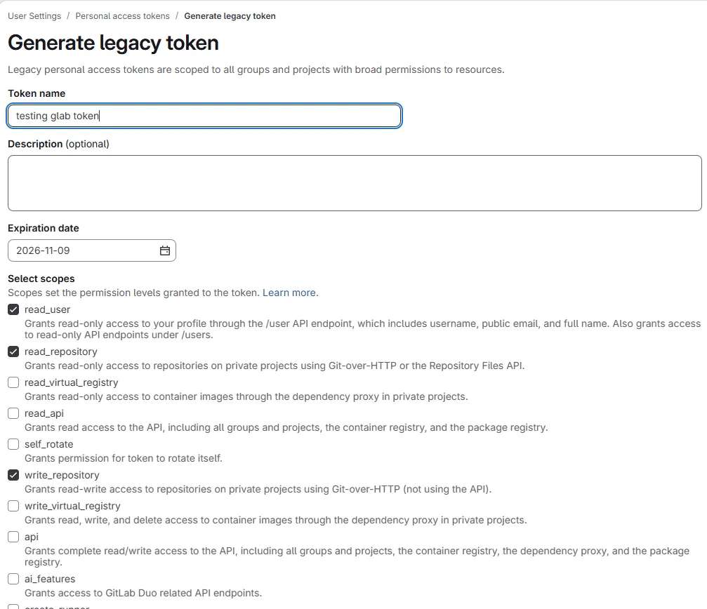

# [GitLab CLI (glab)](https://docs.gitlab.com/cli/)

## Install

Use the [brew](https://brew.sh/) to instal.

More up to date.

[Automation script to install script example](/.scripts/setup/brew/install.sh)

```console
brew install glab
```

## Generate Token

- Log in [gitlab.hs-esslingen.de](https://gitlab.hs-esslingen.de/-/user_settings/personal_access_tokens) to create token

- Just use the legacy one. Otherwise it's kinda of nightmare



- Worked with checked:
  - [x] read_user
  - [x] read_repository
  - [x] write_repository

## Configure glab

Input the copied token by running the following command:

```console
glab auth login --hostname gitlab.hs-esslingen.de
```

- Press `Enter` a couple of times to setup using HTTPS
- Use `Ctlr + Shift + V` to paste inside the terminal
